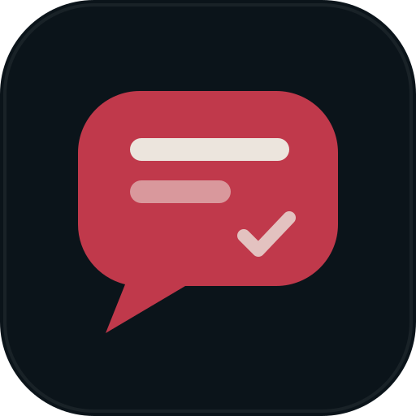

<p align="center"></p>

<h1 align="center">deadchat</h1>
<p align="center"><b>Never delivered.</b><br>A private, offline, read-only home for old WhatsApp chats.</p>

---

DeadChat opens the chat exports WhatsApp makes ("Export chat") and lets you scroll through them the way they looked: bubbles, voice notes, photos, stickers and all. Nothing is ever sent or received, and the app never goes online.

## What it does

- **Import any WhatsApp export:** the `.zip` WhatsApp makes, the `.txt` on its own, or a folder holding the `.txt` and its media. Android and iOS formats, 12h/24h times and day-first or month-first dates all work.
- **Merge exports into one chat.** Import a newer export into an existing chat. Messages already there are skipped, and `<Media omitted>` lines are filled in when the other export has the file.
- **Read it like WhatsApp:**
  - date chips and right-to-left text for Arabic and Hebrew;
  - voice notes with a waveform, 1× / 1.5× / 2× speed, and automatic play of the next one;
  - photos and videos, a photo viewer, and a contact-info panel with a profile photo.
- **Find things:** search the whole chat with `Ctrl/⌘ + F`, or jump to any date.
- **Write what you never sent.** Messages you type stay on your device with a single grey tick. They are never delivered.
- **Export it again** as a WhatsApp-style `.zip`, with or without media and your undelivered messages.

## Private by design

- No accounts, no servers, no analytics.
- Every network request is blocked inside the app. The Android app doesn't even ask for internet permission.
- Imported chats are copied into the app's own folder. Your original files are only read, never changed.
  - Windows: `%APPDATA%\DeadChat`
  - macOS: `~/Library/Application Support/DeadChat`
  - Linux: `~/.config/DeadChat`
  - Android: the app's private storage
- Removing a chat in DeadChat deletes only that copy.

## Download

Get the latest version from **[Releases](https://github.com/PISTAfff/deadchat/releases/latest)**.

| System | File |
|---|---|
| Windows 10/11 | `DeadChat-…-windows-setup.exe` |
| macOS (Apple silicon and Intel) | `DeadChat-…-mac-universal.dmg` |
| Linux | `.AppImage` or `.deb` |
| Android 7+ | `DeadChat-…-android.apk` |

The builds aren't code-signed yet:
- **Windows:** SmartScreen may warn you. Choose **More info**, then **Run anyway**.
- **macOS:** if it says the app "is damaged", run `xattr -cr /Applications/DeadChat.app` once.
- **Android:** open the `.apk` on your phone and allow installing from that source when Android asks.

## How to export a chat from WhatsApp

Open the chat, then **⋮ → More → Export chat** on Android, or **contact name → Export Chat** on iPhone. Choose **Include media** if you want the voice notes and photos. Move the `.zip` to your computer, then use **Import** in DeadChat.

## Build it yourself

```bash
npm ci
npm start          # run in development
npm test           # parser, merge and export tests
npm run dist       # installers for the current system, in dist/
```

### Android

The phone app is the same interface, packaged with [Capacitor](https://capacitorjs.com). It has its own storage layer (`renderer/web-api.js`, using IndexedDB and a service worker for media) and a one-screen-at-a-time layout.

```bash
npm run android                      # copy the app into android/ and sync
cd android && ./gradlew assembleRelease
```

You need JDK 17+ and the Android SDK. Release signing reads `DEADCHAT_KEYSTORE`, `DEADCHAT_KEYSTORE_PASSWORD`, `DEADCHAT_KEY_ALIAS` and `DEADCHAT_KEY_PASSWORD`. Without them, the build is debug-signed.

### Releases

Pushing a tag like `v1.0.1` runs the Release workflow. It builds the Windows, macOS, Linux and Android versions and publishes them as one GitHub Release. To sign the APK in CI, add `ANDROID_KEYSTORE_B64` (the keystore, base64) and `ANDROID_KEYSTORE_PASSWORD` as repository secrets.

## License

[MIT](LICENSE)
